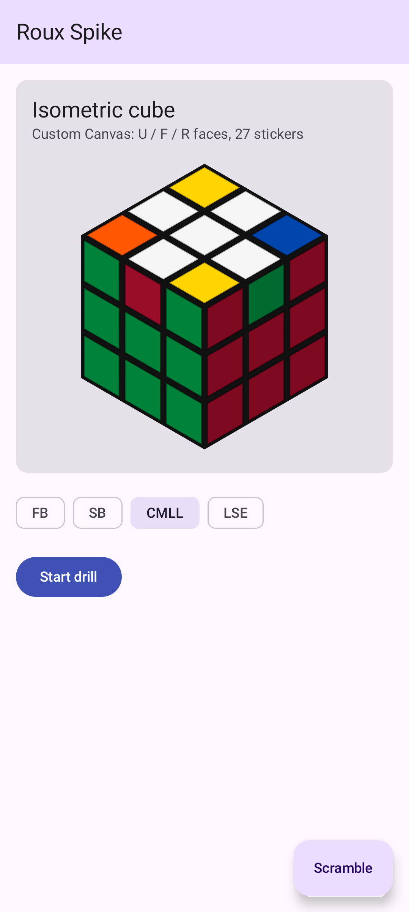
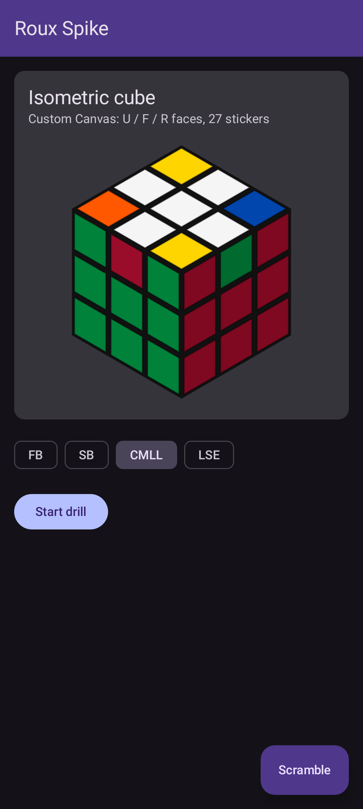

# Cloud toolchain: build and *see* a Compose app in this container (verified 2026-10-28)

Spike: a hand-written Kotlin + Compose + Material 3 app (Scaffold, TopAppBar, Card, FilterChips,
Button, Extended FAB, plus a custom `Canvas` isometric 3x3 cube) built in the Claude Code cloud container
(Linux x86_64, 4 CPU, 15 GB RAM, OpenJDK 21.0.12, **no /dev/kvm**). Everything below was run here.

## Verdict

**Works headlessly:** SDK install (about 1 min), `./gradlew assembleDebug`, plain JUnit tests, Robolectric
Compose UI tests (click/assert), **Roborazzi screenshots** (light and dark both render correctly, including
the custom Canvas cube and Material elevation shadows), pixel-diff verification with a readable diff image,
`./gradlew lint`, and Google's new `android preview render` (renders `@Preview` to PNG with no device).

**Does not work:** the emulator (no KVM), so no `connectedAndroidTest`/instrumented tests, no `adb install`/run,
no real touch latency, frame timing, Bluetooth (smart cubes), sensors, haptics or audio. GL/SurfaceView
content won't render in JVM screenshots either. Those need the user's phone (see the last section).

You need three fixes before it works (all in the setup script or build files below): a Maven Central mirror
(fixes HTTP 429), a Robolectric `--add-opens` flag, and an espresso upgrade.

| Light (Roborazzi, Pixel 7 qualifiers) | Dark |
|---|---|
|  |  |

## Exact versions (latest stable on 2026-10-28, read from Google Maven / Maven Central / services.gradle.org)

| Component | Version | Notes |
|---|---|---|
| cmdline-tools | 23.0 (`commandlinetools-linux-16111833_latest.zip`, 181 MB, sha1 `e025545c…5f60`) | `sdkmanager` now wraps the new `android` CLI 1.1 |
| platform-tools | 37.0.1 (9 MB) | |
| platform | `platforms;android-37.0` (Android 17, 67 MB) | `compileSdk = 37` maps to it. 37.1/37.2 minor releases also exist |
| build-tools | 37.0.0 (66 MB) | pin it with `buildToolsVersion`, see gotcha 3 |
| Gradle (wrapper) | 9.8.2 | `/opt/gradle` is 8.14.3; use it only to generate the wrapper |
| AGP | 9.5.0 | built-in Kotlin, so **no** `kotlin-android` plugin in modules |
| Kotlin / Compose compiler plugin | 2.4.21 | AGP ships KGP 2.2.10; root `apply false` upgrades it (`2.2.10 -> 2.4.21` confirmed) |
| Compose BOM | 2026.09.00 (ui 1.12.1, material3 1.4.0) | activity-compose 1.13.0, core-ktx 1.19.1 |
| Robolectric | 4.17 (runs SDK 37 via `android-all-instrumented:17-robolectric-15733970-i7`, 239 MB) | |
| Roborazzi | 1.77.0 (`roborazzi`, `-compose`, `-junit-rule`, Gradle plugin `io.github.takahirom.roborazzi`) | |
| Test deps | junit 4.13.2, espresso-core 3.7.0, androidx.test:core 1.7.0 | espresso pin is required, see gotcha 5 |

## Exact commands

```bash
# 1. SDK + Maven mirror + local.properties + env (idempotent; about 52 s fresh, 0 s when already installed)
bash docs/roux-android/setup-android-sdk.sh path/to/android-project   # SDK -> $HOME/android-sdk
#    Manual equivalent: unzip cmdline-tools to $SDK/cmdline-tools/latest, then
#    $SDK/cmdline-tools/latest/bin/sdkmanager --sdk_root=$SDK platform-tools "platforms;android-37.0" "build-tools;37.0.0"
#    (no `yes | sdkmanager --licenses` needed: cmdline-tools 23 writes licenses/android-sdk-license itself)

# 2. Wrapper (once, in an empty dir with only settings.gradle.kts, before AGP is declared)
/opt/gradle/bin/gradle wrapper --gradle-version 9.8.2 --distribution-type bin \
  --gradle-distribution-sha256-sum 21bd5da2de49b642904077f38c0efdc7778e92b3ed0889392dca61b97e389607

# 3. Build / test / see
./gradlew assembleDebug                      # app/build/outputs/apk/debug/app-debug.apk (11.7 MB, unminified)
./gradlew testDebugUnitTest                  # JUnit + Robolectric
./gradlew recordRoborazziDebug               # writes reference PNGs
./gradlew verifyRoborazziDebug               # fails on any pixel diff and writes *_compare.png
./gradlew lint                               # app/build/reports/lint-results-debug.txt
```

Build-file essentials (the spike's `app/build.gradle.kts`):

```kotlin
plugins { alias(libs.plugins.android.application); alias(libs.plugins.kotlin.compose); alias(libs.plugins.roborazzi) }
// root build.gradle.kts: android-application, kotlin-android, kotlin-compose, roborazzi all `apply false`
android {
    compileSdk = 37; buildToolsVersion = "37.0.0"
    defaultConfig { minSdk = 26; targetSdk = 37 }
    compileOptions { sourceCompatibility = JavaVersion.VERSION_17; targetCompatibility = JavaVersion.VERSION_17 }
    buildFeatures { compose = true }
    testOptions.unitTests {
        isIncludeAndroidResources = true
        all {
            it.systemProperty("robolectric.pixelCopyRenderMode", "hardware") // real shadows/elevation
            it.maxHeapSize = "2g"
            it.jvmArgs("--add-opens=java.base/jdk.internal.access=ALL-UNNAMED") // gotcha 4
        }
    }
}
roborazzi { outputDir.set(file("src/test/screenshots")) }
// gradle.properties: org.gradle.jvmargs=-Xmx4g -XX:+UseParallelGC, org.gradle.caching=true,
// org.gradle.configuration-cache=true, kotlin.daemon.jvmargs=-Xmx2g. No OOMs at these settings, and no proxy settings are needed.
```

Screenshot test pattern (`app/src/test/...`):

```kotlin
@RunWith(RobolectricTestRunner::class)
@GraphicsMode(GraphicsMode.Mode.NATIVE)
@Config(qualifiers = RobolectricDeviceQualifiers.Pixel7)
class SpikeScreenshotTest {
    @get:Rule val compose = createComposeRule()   // androidx.compose.ui.test.junit4.v2 (v1 is deprecated)
    @Test fun light() { compose.setContent { SpikeTheme(darkTheme = false) { SpikeScreen() } }
        compose.onRoot().captureRoboImage("src/test/screenshots/spike_light.png") }
    @Test @Config(qualifiers = "+night") fun dark() { /* same, darkTheme = true */ }
}
```

## Timings (this container)

| Step | Time |
|---|---|
| cmdline-tools download (181 MB) | 7 s |
| sdkmanager: platform-tools + platform 37 + build-tools 37 | 20 s |
| setup script end-to-end, fresh / already installed | 52 s / 0 s |
| wrapper generation + Gradle 9.8.2 download | 41 s + 9 s |
| **first (cold) `assembleDebug`**, empty dependency cache | **3 min 04 s** |
| second `assembleDebug` (no-op) / one-file change / `clean` with warm daemon | 3 s / 4 s / 12 s |
| first Robolectric test run (downloads the 239 MB SDK 37 jar) | about 60 s |
| `recordRoborazziDebug` / `verifyRoborazziDebug` (2 screenshots + 4 other tests) | 26 s / 26 s |
| first `lint` | 45 s |
| warm `assembleDebug verifyRoborazziDebug lint` together | 19 s |
| `android preview render` first run / warm | 218 s (downloads about 800 MB) / 15 s |

Disk: SDK 511 MB (+147 MB if AGP auto-fetches build-tools 36), `~/.gradle` 2.3 GB (deps 556 MB, Gradle 9.8.2
transforms 1.1 GB, build cache 363 MB, wrapper 165 MB), `~/.m2` 228 MB (Robolectric jar), `~/.android`
about 250 MB (the `android` CLI copies itself there on first use) or 1.1 GB after `android preview`.
**Total about 3.3 GB, or 4.2 GB with `android preview`.**

## Gotchas and fixes

1. **Maven Central returns HTTP 429** (Sonatype rate-limits the shared egress IP). The symptom is
   `Plugin [id: 'org.jetbrains.kotlin.plugin.compose', version: '2.4.21'] was not found`, and `--info` shows
   `HTTP 429: https://repo.maven.apache.org/...`. Fix: the setup script writes
   `~/.gradle/init.d/cloud-maven-mirror.init.gradle.kts`, which rewrites `mavenCentral()` to
   `https://maven-central.storage-download.googleapis.com/maven2/` (Google's mirror) and sets
   `robolectric.dependency.repo.url` for test JVMs. The project keeps plain `mavenCentral()`, so it stays portable.
2. **`sdkmanager` is deprecated in cmdline-tools 23.** It's a shell wrapper around `bin/android sdk install`,
   prints a banner, and `--licenses` is a no-op (the license is accepted implicitly). `~/.android/analytics.settings` defaults to `hasOptedIn:false`.
3. **AGP 9.5 auto-downloads build-tools 36.0.0** (its default) on the first build, even if 37.0.0 is installed.
   Auto-download works here because the license file and proxy are in place. To avoid the surprise, pin `buildToolsVersion = "37.0.0"`.
4. **Robolectric 4.17 + SDK 37 + JDK 21** fails with `IllegalAccessException ... jdk.internal.access` from
   `ApplicationSharedMemory.create`. Fix: `--add-opens=java.base/jdk.internal.access=ALL-UNNAMED` on unit-test JVMs.
5. **Compose ui-test 1.12.1 pulls espresso-core 3.5.1**, which crashes on SDK 37 with
   `NoSuchMethodException: InputManager.getInstance()`. Fix: `testImplementation` espresso-core 3.7.0 and
   androidx.test:core 1.7.0. (Untested alternative: run Robolectric at `@Config(sdk = [36])`.)
6. **AGP 9 built-in Kotlin:** applying `org.jetbrains.kotlin.android` in a module is an error. Declare it only
   at the root with `apply false` to pin KGP 2.4.21. Apply `org.jetbrains.kotlin.plugin.compose` in the module.
7. `createComposeRule` from `junit4` is deprecated; use `androidx.compose.ui.test.junit4.v2.createComposeRule`.
8. With `outputDir = src/test/screenshots`, a failed verify also writes `*_actual.png` and `*_compare.png` there.
   Add them to `.gitignore`.
9. Kotlin comments nest: a KDoc containing `screenshots/*.png` opens a second comment ("Unclosed comment").
10. Harmless output you can ignore: `Unable to strip ... libandroidx.graphics.path.so` (no NDK installed), and one
    transient `dl.google.com ws_closed_mid_exchange` proxy blip (Gradle retried it). The proxy comes from
    `JAVA_TOOL_OPTIONS`, which every JVM (wrapper, daemon, test workers) picks up automatically.

## Screenshot-verification workflow for an agent

1. For each screen/state, add a Roborazzi test (light and dark, plus key states such as "cube mid-turn" or "timer running").
   Also keep `@Preview`s for quick looks.
2. `./gradlew recordRoborazziDebug`, or for one class:
   `./gradlew testDebugUnitTest --tests '*SpikeScreenshotTest*' -Proborazzi.test.record=true` (16 s warm).
3. **Open each PNG with the Read tool** (1078x2399, about 150 KB) and check the layout, colours, text and Canvas
   drawing against intent. Don't claim a UI works without looking at the image.
4. Commit the reference PNGs. After later changes run `./gradlew verifyRoborazziDebug`. On failure, Read
   `app/build/outputs/roborazzi/<name>_compare.png`, which shows reference, diff (changed pixels in red) and new side by side.
   In the spike, a one-sticker colour change was caught and highlighted exactly. Re-record when a change is intended.
5. Use Compose semantics tests (`onNodeWithText(...).performClick()`, `assertIsSelected()`) for behaviour.
   Robolectric runs them on the JVM. `mainClock` control is available for animations and timers.
6. Quick look without test code: `android preview list "$PWD?:app"`, then
   `android preview render --fqn dev.pkg.FileKt.MyPreview -o /tmp/out "$PWD?:app"` (layoutlib render;
   `--component-tree` also dumps a JSON tree).

## Limits and testing on the user's phone

Here you can't test real-device rendering speed (jank/frame time), touch and gesture feel, BLE smart cubes,
the StackMat timer audio input, sensors/haptics, OEM font/DPI quirks, or install/upgrade behaviour.
Suggested loop: CI builds the debug APK, the user installs it on the phone.

```yaml
# .github/workflows/android.yml (GitHub runners already have an Android SDK; no mirror init script needed there)
on: [push, workflow_dispatch]
jobs:
  apk:
    runs-on: ubuntu-latest
    steps:
      - uses: actions/checkout@v7
      - uses: actions/setup-java@v6
        with: { distribution: temurin, java-version: 21 }
      - uses: gradle/actions/setup-gradle@v6
      - run: ./gradlew assembleDebug verifyRoborazziDebug lint
      - uses: actions/upload-artifact@v7
        with: { name: app-debug, path: app/build/outputs/apk/debug/app-debug.apk }
```

The user opens the run in a phone browser, downloads `app-debug.zip`, unzips it, taps the APK and allows
"install unknown apps". Or from a computer: `adb install -r app-debug.apk`. **Caveat:** each CI runner
generates a fresh debug keystore, so updating over an earlier install fails with
`INSTALL_FAILED_UPDATE_INCOMPATIBLE`. Either uninstall first, or sign debug builds with a fixed keystore stored
as a repo secret. Later, Firebase App Distribution or a Play internal-testing track gives one-tap updates.
Record Roborazzi references on Linux (here or CI). References recorded on macOS may differ in font rasterisation.
